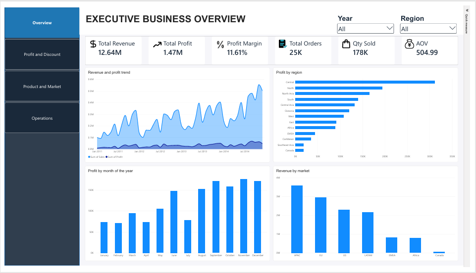
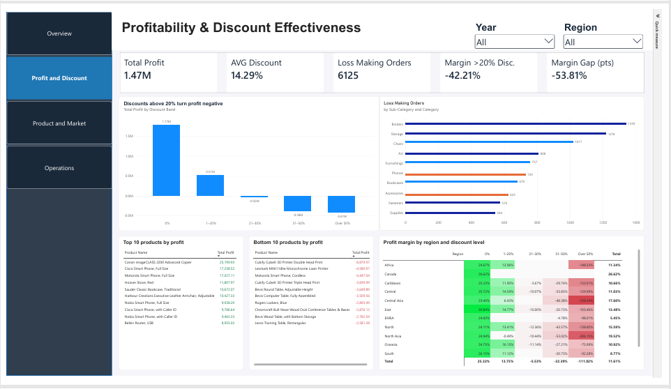
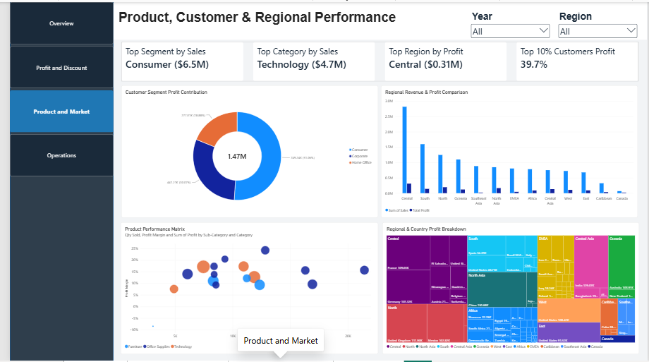
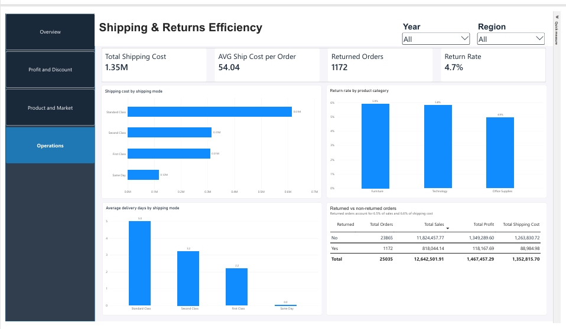

# Global Superstore: Business Performance & Profitability Analysis

An analysis of Global Superstore sales data to find where the business loses money and how discounts affect profit.

## Business Problem
Which discounts, products, regions and shipping choices help profit, and which ones hurt it?

## Tools Used
- **Python (pandas):** data cleaning and joining the tables
- **Excel:** data inspection
- **Power BI:** a 4-page interactive dashboard

## Dataset
Global Superstore sales data with three sheets: Orders, Returns and People.

After cleaning and joining, the final dataset has **51,290 rows**.

## Data Cleaning
- Renamed "United States" to "US" in the Returns sheet so it matches the Orders sheet
- Fixed a typo in the People sheet ("AMEA" corrected to "EMEA")
- Joined Returns to Orders using both Order ID and Market, because the same Order ID appears in more than one market

## Dashboard Pages
1. **Executive Business Overview**
2. **Profitability & Discount Effectiveness**
3. **Product, Customer & Regional Performance**
4. **Shipping & Returns Efficiency**

## Key Findings
- The average discount across all orders is **14.29%**
- **6,125 orders** made a loss
- Orders with no discount earn the highest profit
- Losses begin in the **21-30% discount band** and get worse as discounts grow
- Orders with discounts above 30% have a profit margin of **-51.27%**

## Dashboard Screenshots

## Repository Structure
- `notebooks/`: Python cleaning notebook
- `data/`: cleaned dataset
- `dashboard/`: Power BI file
- `images/`: dashboard screenshots
